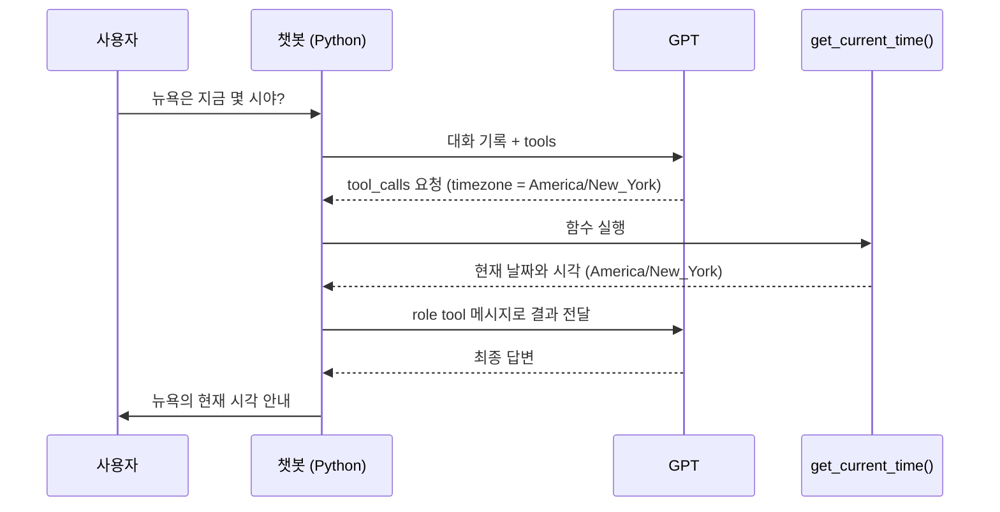
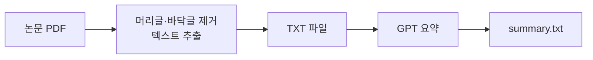
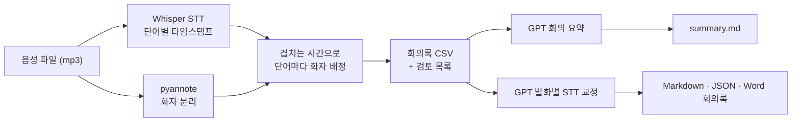

# LUNA · LLM 활용 실습 모음

OpenAI API와 Whisper로 **챗봇 → 프롬프트 → Function Calling → 문서 요약 → 회의록 자동화**까지 단계별로 직접 만들어 본 Python 실습 저장소입니다.

각 폴더가 하나의 실습이며, 앞 단계에서 익힌 내용을 다음 단계에서 다시 사용하는 순서로 구성했습니다.

<br>

## 실습 한눈에 보기

| 단계 | 폴더 | 내용 | 핵심 기술 |
|:---:|---|---|---|
| 1 | [`gpt_basic`](gpt_basic) | 첫 Chat Completions API 호출 | `openai`, `python-dotenv` |
| 2 | [`gpt_chatbot/multi_turn`](gpt_chatbot/multi_turn) | 싱글턴 vs 멀티턴 챗봇 비교 | 대화 기록(`messages`) 관리 |
| 3 | [`gpt_chatbot/prompting`](gpt_chatbot/prompting) | Zero / One / Few-shot, 역할 부여 | 프롬프트 엔지니어링 |
| 4 | [`function_calling`](function_calling) | GPT가 필요한 함수를 골라 호출하는 챗봇 | `tools`, `tool_calls`, `pytz` |
| 5 | [`pdf_summary`](pdf_summary) | 논문 PDF → 텍스트 추출 → 구조화된 요약 | `PyMuPDF` |
| 6 | [`whisper`](whisper) | 음성 인식 + 화자 분리 + 회의록 요약·교정 | Whisper, `pyannote.audio`, `pandas`, `python-docx` |

<br>

## 기술 스택

| 분류 | 사용 기술 |
|---|---|
| 언어 / 환경 | Python 3.12, venv, Jupyter Notebook, VS Code + Ruff |
| LLM | OpenAI Chat Completions (`gpt-6-luna`) |
| 음성 인식 | OpenAI Whisper API (`whisper-1`), Hugging Face Transformers (`openai/whisper-large-v3-turbo`) |
| 화자 분리 | `pyannote.audio` 3.3 (`pyannote/speaker-diarization-3.1`) |
| 딥러닝 | PyTorch 2.7 (CUDA 12.8), torchaudio, FFmpeg |
| 데이터 처리 | PyMuPDF, pandas, pytz, python-docx |

<br>

## 폴더 구조

```text
LUNA/
├── gpt_basic/
│   └── gpt_basic.py                     # 첫 API 호출
├── gpt_chatbot/
│   ├── multi_turn/
│   │   ├── single_turn.py               # 이전 대화를 기억하지 않는 챗봇
│   │   └── multi_turn.py                # 대화 기록을 유지하는 챗봇
│   └── prompting/
│       ├── few_shot/                    # no_prompting · one_shot · few_shot
│       └── mirror_in_snow_white/        # 역할 부여 프롬프트
├── function_calling/
│   └── gpt_function/
│       ├── gpt_function.py              # get_current_time() + tools 스키마
│       └── what_time_is_it_terminal_0.py  # Function Calling 터미널 챗봇
├── pdf_summary/
│   ├── data/                            # 원본 논문 PDF
│   ├── output/                          # 추출한 텍스트 · 요약 결과
│   ├── pdf_without_header_footer/       # PDF → TXT 변환
│   └── pdf_summary/                     # TXT → GPT 요약
├── whisper/
│   ├── audio/                           # 원본 음성 · STT/화자 분리 결과
│   ├── whispe_api/                      # OpenAI Whisper API
│   ├── huggingface_whisper/             # 로컬 Whisper 모델
│   ├── speaker_diarization/             # STT + 화자 분리 스크립트
│   └── summarize_and_correct/           # 회의록 요약 · STT 교정 · 문서 내보내기
├── .env                                 # API 키 (Git에서 제외)
└── README.md
```

<br>

## 시작하기

### 1. 준비물

- Python 3.12
- OpenAI API 키
- 6단계(whisper)를 실행하려면 추가로
  - Hugging Face 토큰
  - Hugging Face에서 [`pyannote/speaker-diarization-3.1`](https://huggingface.co/pyannote/speaker-diarization-3.1), [`pyannote/segmentation-3.0`](https://huggingface.co/pyannote/segmentation-3.0) 모델 이용 약관 동의
  - FFmpeg
  - NVIDIA GPU 권장 (없으면 CPU로 동작하지만 느립니다)

### 2. 가상환경 만들기

```powershell
python -m venv venv
.\venv\Scripts\Activate.ps1
```

### 3. 패키지 설치

```powershell
# 1~5단계
pip install openai python-dotenv pytz pymupdf

# 6단계 (whisper)
pip install "torch==2.7.1+cu128" "torchvision==0.22.1+cu128" "torchaudio==2.7.1+cu128" --index-url https://download.pytorch.org/whl/cu128
pip install "pyannote.audio==3.3.2" "transformers==4.55.4" "huggingface-hub==0.34.4" "accelerate==1.15.0" "numpy==2.5.4" pandas python-docx
```

> 노트북(`.ipynb`) 첫 셀에도 같은 설치 명령이 들어 있습니다. 설치 후에는 커널을 재시작해 주세요.

### 4. 환경 변수 설정

프로젝트 루트에 `.env` 파일을 만들고 키를 넣습니다. `.env`는 `.gitignore`에 등록되어 있어 커밋되지 않습니다.

```env
OPENAI_API_KEY=sk-...
HUGGING_FACE_TOKEN=hf_...
```

### 5. FFmpeg 배치

Whisper와 torchaudio가 mp3/m4a 파일을 읽을 때 FFmpeg가 필요합니다.
[FFmpeg 빌드](https://www.gyan.dev/ffmpeg/builds/)를 프로젝트 루트에 `ffmpeg-2026-10-15-git-afead44165-full_build` 폴더로 풀어 두면, 코드가 실행될 때 `bin` 폴더를 `PATH`에 자동으로 추가합니다. (이 폴더도 `.gitignore` 처리되어 있습니다.)

> [!NOTE]
> 코드 안의 파일 경로는 `C:\LUNA` 기준으로 적혀 있습니다.
> 다른 위치에 clone했다면 각 스크립트의 `base_dir`, `AUDIO`, `FFMPEG_BIN` 같은 경로 변수를 바꿔 주세요.

<br>

## 실습 상세

### 1. gpt_basic — 첫 API 호출

`.env`에서 API 키를 읽어 `system`, `user` 메시지 한 쌍을 보내고 답변을 출력합니다.
이후 모든 실습이 이 구조(`load_dotenv` → `OpenAI` 클라이언트 → `chat.completions.create`)를 기본으로 사용합니다.

```powershell
python gpt_basic\gpt_basic.py
```

<br>

### 2. gpt_chatbot/multi_turn — 싱글턴 vs 멀티턴

| 파일 | 동작 | 결과 |
|---|---|---|
| `single_turn.py` | 매번 `system` + 현재 질문만 전송 | 바로 앞의 대화도 기억하지 못함 |
| `multi_turn.py` | `messages` 리스트에 `user`/`assistant` 메시지를 계속 추가해 전송 | 이전 대화를 이어서 답변 |

API 서버는 대화를 저장하지 않습니다. 챗봇의 "기억"은 **클라이언트가 지금까지의 대화 기록을 매번 다시 보내서** 만들어진다는 점을 두 파일로 비교했습니다.

```powershell
python gpt_chatbot\multi_turn\multi_turn.py   # exit 또는 quit 입력 시 종료
```

<br>

### 3. gpt_chatbot/prompting — 프롬프트 엔지니어링

"너는 유치원생이야"라는 같은 `system` 프롬프트에서 **예시 개수**만 바꿔 답변이 어떻게 달라지는지 비교합니다.

| 파일 | 방식 | 대화 예시 → 마지막 질문 |
|---|---|---|
| `few_shot/no_prompting.py` | Zero-shot | (예시 없음) → 오리 |
| `few_shot/one_shot.py` | One-shot | 참새 → 짹짹 → 오리 |
| `few_shot/few_shot.py` | Few-shot | 참새 → 짹짹, 말 → 히이잉, 개구리 → 개굴개굴 → 뱀 |
| `mirror_in_snow_white/mirror_in_snow_white.py` | 역할 부여 | 백설공주 속 "마법 거울" 캐릭터로 답변 |

`user`/`assistant` 메시지 쌍으로 예시를 넣으면, 모델이 그 형식(울음소리로 답하기)을 따라 답변하게 됩니다.

<br>

### 4. function_calling — 함수를 호출하는 챗봇

GPT는 현재 시각을 알 수 없습니다. 그래서 시각을 알려 주는 파이썬 함수를 **도구(tool)** 로 등록하고, 필요할 때 GPT가 그 함수를 호출하도록 만들었습니다.

| 파일 | 역할 |
|---|---|
| `gpt_function.py` | `get_current_time(timezone)` 함수와, GPT에게 함수를 설명하는 `tools` JSON 스키마 |
| `what_time_is_it_terminal_0.py` | Function Calling 흐름을 처리하는 터미널 챗봇 |



**구현 포인트**

- GPT가 함수 호출을 요청하지 않을 때까지 안쪽 `while` 루프를 반복해, 한 질문에 여러 번 함수를 호출해도 처리할 수 있습니다.
- `tool_calls`가 담긴 `assistant` 메시지를 **함수 결과보다 먼저** 대화 기록에 추가해야 합니다.
- 함수 결과는 `role: "tool"` 메시지에 `tool_call_id`를 붙여, 어떤 호출에 대한 결과인지 연결합니다.
- GPT가 넘겨주는 `arguments`는 JSON 문자열이라 `json.loads()`로 파싱합니다.
- 등록되지 않은 함수 이름이 오면 실행하지 않고 안내 문구를 돌려줍니다.
- `gpt-6-luna`에서 Chat Completions로 함수 도구를 쓰려면 `reasoning_effort="none"`을 지정해야 합니다.

```powershell
cd function_calling\gpt_function   # gpt_function 모듈을 같은 폴더에서 import합니다
python what_time_is_it_terminal_0.py
```

> 🚧 Streamlit 웹 화면 버전(`what_time_is_it_streamlit.py`)을 작업 중입니다.

<br>

### 5. pdf_summary — 논문 PDF 요약



| 파일 | 역할 |
|---|---|
| `pdf_without_header_footer/pdf_to_txt.py` | PDF 전체 텍스트를 그대로 추출 |
| `pdf_without_header_footer/pdf_without_header_footer.py` | 페이지 위·아래 영역을 잘라내고(`clip`) 본문만 추출 |
| `pdf_summary/summary.py` | 추출한 TXT를 GPT로 요약 |
| `pdf_summary/pdf_summary.py` | 추출과 요약을 `summarize_pdf()` 함수 하나로 묶은 최종본 |

- 학술지 이름, 쪽 번호처럼 페이지마다 반복되는 머리글·바닥글을 PyMuPDF의 `clip` 영역 지정으로 제외해 요약에 불필요한 텍스트가 섞이지 않게 했습니다.
- 요약 형식은 프롬프트로 고정했습니다: `# 제목` / `## 저자의 문제 인식 및 주장 (15문장 이내)` / `## 저자 소개`
- 결과 예시: [`pdf_summary/output/summary.txt`](pdf_summary/output/summary.txt) — 「달 자원 탐사와 달 기지 연구 동향」 요약

```powershell
python pdf_summary\pdf_summary\pdf_summary.py
```

<br>

### 6. whisper — 음성 인식 · 화자 분리 · 회의록 자동화

음성 파일에서 **누가, 언제, 무엇을 말했는지** 뽑아내고, GPT로 회의록을 요약·교정해 문서로 내보냅니다.



#### 6-1. 음성 인식 두 가지 방법

| 노트북 | 방식 | 특징 |
|---|---|---|
| `whispe_api/openai_api_whisper.ipynb` | OpenAI Whisper API (`whisper-1`) | 설치 없이 API로 바로 변환 |
| `huggingface_whisper/huggingface_whisper.ipynb` | 로컬 모델 (`openai/whisper-large-v3-turbo`) | GPU에서 float16으로 실행, 10초 단위로 나누고 2초씩 겹쳐 인식, 구간별 타임스탬프를 CSV로 저장 |

#### 6-2. 화자 분리 — 버전별 개선 과정

`speaker_diarization/` 폴더에는 문제를 하나씩 해결하며 고쳐 온 스크립트가 순서대로 남아 있습니다.

| 파일 | 내용 |
|---|---|
| `whisper_stt_0.py` | Whisper STT 결과를 `start`, `end`, `text` CSV로 저장 |
| `whisper_stt_1.py` | pyannote 3.1 화자 분리 추가. RTTM 파일을 CSV로 바꾸고, 같은 화자가 이어 말한 구간을 하나로 묶음 |
| `whisper_stt_fail.py` | STT 문장 청크와 화자 구간을 겹치는 시간으로 매칭한 첫 시도. 청크 단위라 한 청크에 여러 화자가 섞이면 한 사람에게 몰리고, 겹치는 구간이 없는 청크는 결과에서 빠짐 |
| `whisper_stt_last.py` | **최종본.** 아래 개선 사항 반영 |

`whisper_stt_last.py`에서 개선한 점

- **단어 단위 타임스탬프**(`return_timestamps="word"`)로 화자를 배정해 정확도를 높였습니다.
- 인식된 단어를 하나도 버리지 않고, 화자를 정할 수 없으면 `UNKNOWN`으로 남깁니다.
- 단어마다 배정 상태를 기록하고, 확인이 필요한 항목만 `review.csv`로 따로 모읍니다.

  | status | 의미 |
  |---|---|
  | `matched` | 한 화자 구간과 50% 이상 겹침 |
  | `partial_overlap` | 겹치지만 50% 미만 |
  | `multiple_speakers` | 여러 화자 구간과 겹침 |
  | `no_overlap` | 겹치는 화자 구간이 없음 → `UNKNOWN` |
  | `invalid_timestamp` | 타임스탬프가 없거나 비정상 → `UNKNOWN` |

- 실행할 때마다 `오디오이름_result_날짜시간/` 폴더를 새로 만들어 이전 결과를 보존합니다.
- STT가 끝나면 Whisper 모델을 메모리에서 해제한 뒤 화자 분리를 실행해 GPU 메모리 부족을 막습니다.
- CSV는 `utf-8-sig`로 저장해 엑셀에서 열어도 한글이 깨지지 않습니다.

생성되는 파일

| 파일 | 내용 |
|---|---|
| `stt_raw.json` | Whisper 원본 결과 |
| `speakers.rttm`, `speaker_segments.csv` | 화자 분리 결과 |
| `words.csv` | 단어별 화자 배정 결과 |
| `review.csv` | 검토가 필요한 단어 목록 |
| `*_by_Whisper_stt_Final.csv` | 화자 구간별로 텍스트를 합친 최종 회의록 |

스크립트 맨 위의 상수로 설정을 바꿀 수 있습니다.

```python
NUM_SPEAKERS = 4      # 화자 수 (모르면 None)
LANGUAGE = "korean"   # 자동 감지는 None
MODEL_ID = "openai/whisper-large-v3-turbo"
```

```powershell
python whisper\speaker_diarization\whisper_stt_last.py
```

#### 6-3. 회의록 요약 · 교정 · 내보내기

`summarize_and_correct/summarize_and_correct.ipynb`

1. 최종 회의록 CSV를 불러와 빈 발화와, 분석에서 뺄 화자(`SPEAKER_00`)·`UNKNOWN`을 제외합니다.
2. `SPEAKER_01` 같은 화자 ID를 실제 인물 이름으로 바꿉니다.
3. 회의록을 JSON으로 바꿔 GPT에 요약을 요청합니다. (`# 회의 제목` / `## 주요 내용` / `## 참석자별 입장` / `## 결정 사항`) → [`summary.md`](whisper/summarize_and_correct/summary.md)
4. 발화를 하나씩 GPT로 교정합니다. 회의 요약과 전체 회의록을 함께 넘겨, 앞뒤 맥락을 보고 STT가 잘못 받아 적은 부분만 고치게 했습니다.
5. 교정한 회의록을 JSON, Markdown, Word(`.docx`) 파일로 저장합니다.

<br>

## 배운 점 · 주의할 점

| 상황 | 방법 |
|---|---|
| 챗봇이 이전 대화를 기억하게 하려면 | API는 상태를 저장하지 않으므로 `messages`에 대화를 누적해 매번 전송 |
| Function Calling에서 함수 결과를 GPT에 넘길 때 | `tool_calls`가 담긴 `assistant` 메시지를 먼저 기록한 뒤 `tool` 메시지 추가 |
| `gpt-6-luna`에서 Chat Completions로 함수 도구를 쓸 때 | `reasoning_effort="none"` 지정 |
| PDF 요약에 쪽 번호·학술지명이 섞임 | PyMuPDF `clip`으로 머리글·바닥글 영역 제외 |
| Whisper가 mp3를 읽지 못함 | FFmpeg `bin` 폴더를 코드에서 `PATH`에 추가 |
| pyannote 모델 로딩 실패 | PyTorch 2.6부터 `torch.load` 기본값이 `weights_only=True`로 바뀌어, `torch.serialization.safe_globals`로 허용할 클래스를 지정 |
| 화자 분리 중 GPU 메모리 부족 | STT 후 모델 삭제 + `torch.cuda.empty_cache()` |
| 한 문장에 여러 화자가 섞여 배정이 틀림 | 문장 청크 대신 단어 단위 타임스탬프로 화자 배정 |
| 엑셀에서 CSV 한글이 깨짐 | `utf-8-sig` 인코딩으로 저장 |
